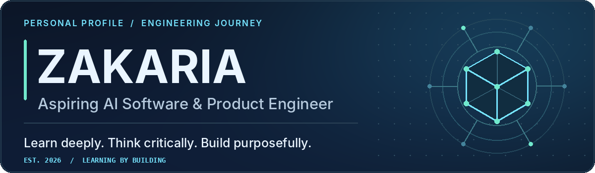
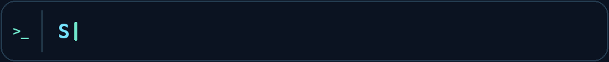
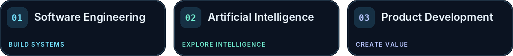
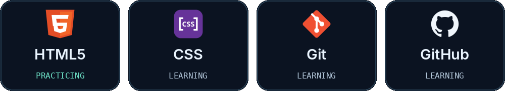
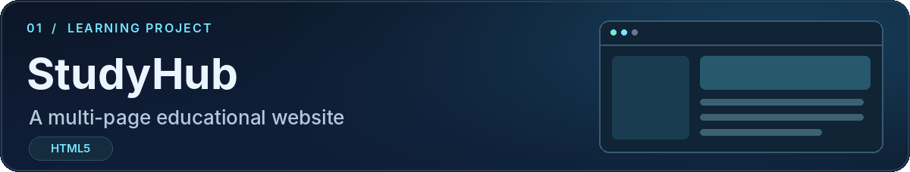
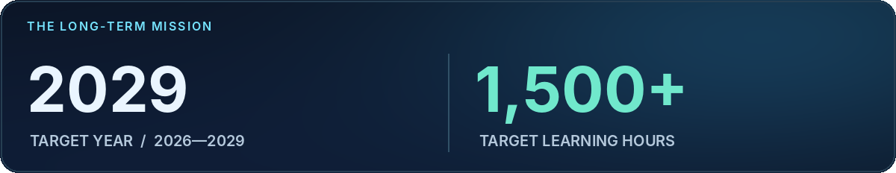
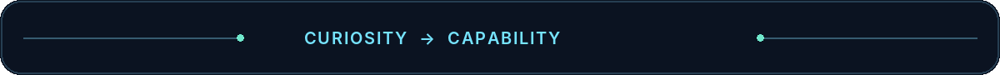

<!-- ==================== HEADER ==================== -->

<div align="center">





<p><strong>Software Engineering · Artificial Intelligence · Product Development</strong></p>



</div>

---

<!-- ==================== ABOUT ==================== -->

## 01 — About Me

I'm a student and aspiring **AI Software & Product Engineer**, driven by curiosity about how technology works and how it can solve meaningful problems.

I'm building a strong foundation in software engineering with the long-term goal of designing, developing, and shipping intelligent software products.

I believe great engineering starts with understanding the problem, not just writing the code.

<!-- ==================== CURRENT FOCUS ==================== -->

## 02 — Current Focus

- **Web Development** — Building strong foundations in HTML and CSS.
- **Developer Workflow** — Learning Git, GitHub, and version control.
- **Engineering Mindset** — Developing problem-solving, technical reasoning, and independent learning skills.

<!-- ==================== TECHNOLOGIES ==================== -->

## 03 — Technologies

<div align="center">



<p><strong>HTML5 · CSS · Git · GitHub</strong></p>

<p><em>My toolkit grows as my understanding grows.</em></p>

</div>

<!-- ==================== PROJECTS ==================== -->

## 04 — Featured Projects

### StudyHub



A multi-page educational website focused on semantic structure, accessible forms, organized content, and practical web development fundamentals.


**Technology:** HTML5

**Focus:**
- Semantic HTML and page structure
- Multi-page navigation
- Forms and tables
- Accessibility fundamentals

*Learning by building, not just watching tutorials.*

<!-- ==================== ROADMAP ==================== -->

## 05 — Engineering Journey

| Learning Area | Status |
|:---|:---|
| Web Development |  |
| Backend Engineering & Databases |  |
| Computer Science & Python |  |
| AI & Intelligent Systems |  |
| Infrastructure, Security & Cloud |  |
| End-to-End Product Engineering |  |

<!-- ==================== MISSION ==================== -->

## 06 — Long-Term Mission

<div align="center">

<h3>2026 — 2029</h3>

<p><strong>1,500+ learning hours · Target: 2029</strong></p>



</div>

To become an independent engineer capable of transforming ideas into useful, reliable, and scalable AI-powered products.

My focus is on developing the ability to understand problems, design solutions, build systems, and deliver real value through technology.

<!-- ==================== PHILOSOPHY ==================== -->

## 07 — Engineering Philosophy

```text
Understand the fundamentals.
Question assumptions.
Build with intention.
Learn from failure.
Improve continuously.
Create real value.
```

---

<!-- ==================== FOOTER ==================== -->

<div align="center">

<h3>Always learning. Always building.</h3>

<p><em>The ambition is not just to write code, but to become an engineer who can turn ideas into reality.</em></p>



</div>
